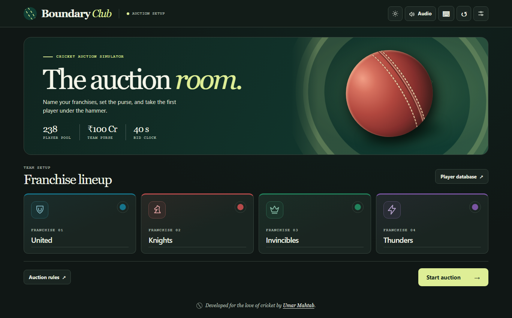
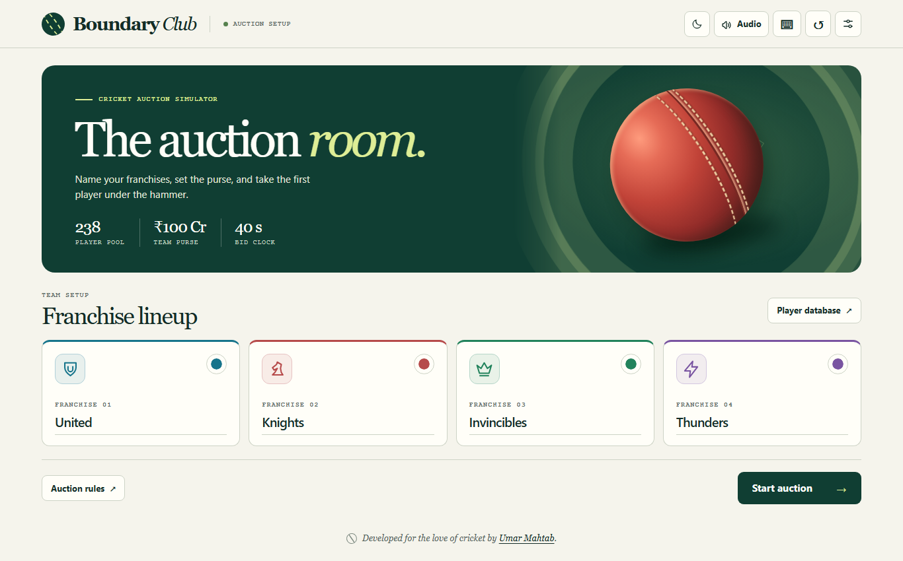
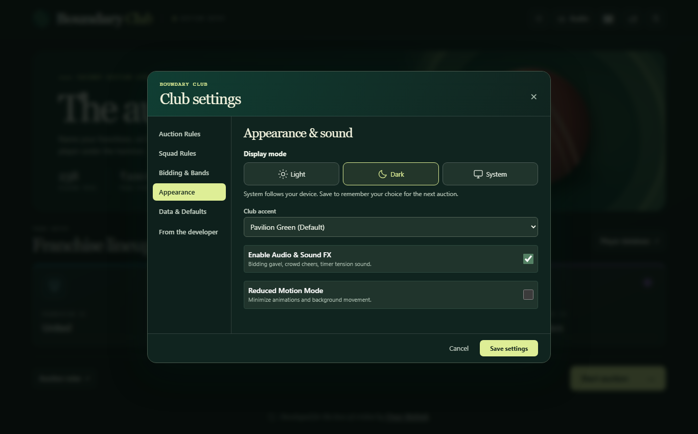
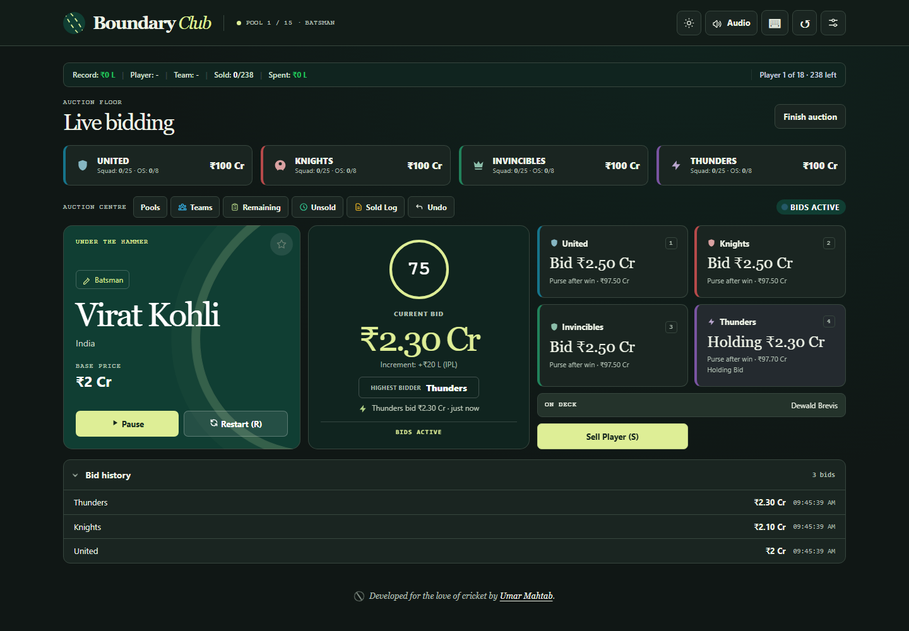
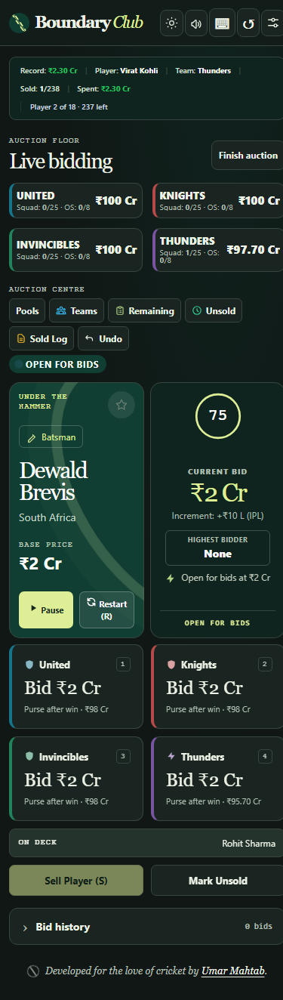
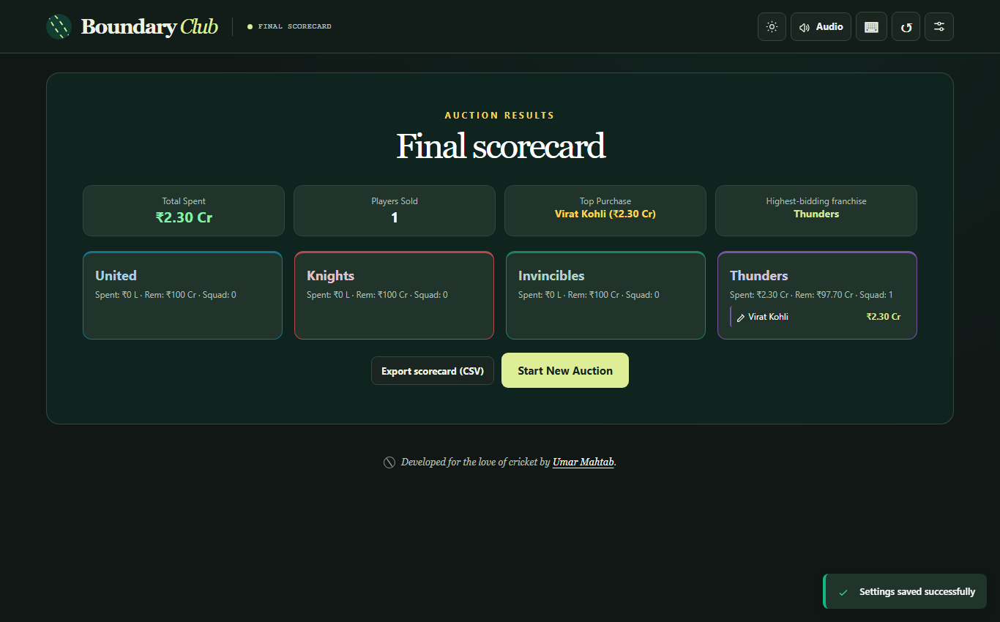

# Boundary Club

> [!IMPORTANT]
> ## This is the latest version of Cricket Auction Simulator (v4) — now renamed **Boundary Club**.
>
> Looking for the previous version?
>
> **Legacy Repository:**  
> [https://github.com/umarmahtab/Cricket-Auction-Simulator-V3](https://github.com/umarmahtab/Cricket-Action-Simulator-V3)
>
> This version includes a redesigned interface, improved auction flow, enhanced performance, better team management, new customization options, and numerous quality-of-life improvements over the original release.

---

**Boundary Club** (Version 4 of *Cricket Auction Simulator*) is a broadcast-grade, four-franchise cricket auction simulator built to run seamlessly on a single screen. Name your franchises, retain your core players, manage team purses in real time, and experience the thrill of the gavel.



## Quick Start

1. **Clone or Download** this repository:
   ```bash
   git clone https://github.com/umarmahtab/BoundaryClub.git
   ```
2. **Open `auction.html`** in any modern desktop or mobile browser. Keep the `sounds/` directory alongside the file for full match audio.
3. **Configure Franchises**: Customize team names and colours on the setup screen. Open **Settings** to adjust starting purses, pacing presets, squad constraints, and retention rules.
4. **Run the Auction**: Conduct the retention phase, open player pools, place bids with the franchise cards or number keys (`1`–`4`), and sell or pass lots.
5. **Review & Export**: Conclude the auction to inspect final squad compositions, review spending charts, and download CSV/PDF scorecards.

Runs 100% locally with vanilla JavaScript, modern CSS, and zero build dependencies.

---

## What’s New in v4 (Boundary Club)

| Area | Highlights |
| --- | --- |
| **Rebranding & Identity** | Renamed from *Cricket Auction Simulator* to **Boundary Club** (v4) with an esports/broadcast war-room design aesthetic. |
| **Tactile 2026 UI** | Micro-rim lighting, glowing franchise border indicators, active bidder pulses, tactile button depression, and zero-scroll laptop viewport optimization. |
| **Auction Centre** | One-click access to **Teams Dashboard** (role breakdown & completeness meters), **Remaining Players** (filters & shortlisting), **Pool Navigator**, **Unsold Players** (bulk actions & base price discounts), and **Sold Log**. |
| **Live Bidding Stage** | Circular SVG countdown ring with urgent warning states, live increment calculator, leading bidder indicators, and quick-action gavel controls. |
| **Pacing & Rules** | Blitz (20s), Club (40s), and Test Match (75s) pacing presets with standard and accelerated increment bands. |
| **Reporting & Portability** | Export CSV scorecards and formatted PDF summary reports, plus JSON session backup and restore. |

### Auction Pacing Presets

| Preset | Clock | Bid Increments |
| --- | --- | --- |
| **Blitz** | 20 seconds | Double |
| **Club** | 40 seconds | Standard |
| **Test Match** | 75 seconds | Standard |

*Default starting purse is **₹100 Crore** per franchise with a curated roster of **238 players**. All database edits and imports are saved locally.*

### Keyboard Controls

| Key | Action |
| --- | --- |
| `1` – `4` | Place bid for Franchise 1, 2, 3, or 4 |
| `Space` | Pause / resume the countdown timer |
| `S` | Sell current player to highest bidder |
| `N` | Advance to next player lot |
| `R` | Restart bidding for current player |
| `U` | Undo last recorded auction bid |
| `M` | Toggle sound effects (Mute / Unmute) |
| `?` | Open keyboard shortcuts help modal |

---

## Screenshots

| Franchise Setup | Appearance & Theme Settings |
| --- | --- |
|  |  |



| Mobile Viewport | Final Scorecard |
| --- | --- |
|  |  |

---

Developed for the love of cricket by [Umar Mahtab](https://www.instagram.com/umarmahtab18/). [GitHub](https://github.com/umarmahtab)
